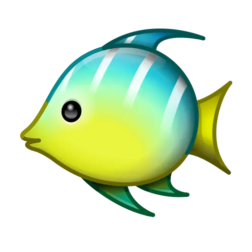

### jigokubana

<h4>
CS student focused on software engineering, algorithms, and system fundamentals. Writing clean, strictly typed code with attention to time and space complexity.
</h4>

- **Focus:** Python, Data Structures & Algorithms, Linux CLI
- **Direction:** Machine Learning & Network Engineering

 

#### Languages

#### Tools

#### Contact
- **Telegram:** [@YaBogImneTakPox](https://t.me/YaBogImneTakPox)
- **Email:** [soooosinister@gmail.com](mailto:soooosinister@gmail.com)

---

 

  Liars lose.

